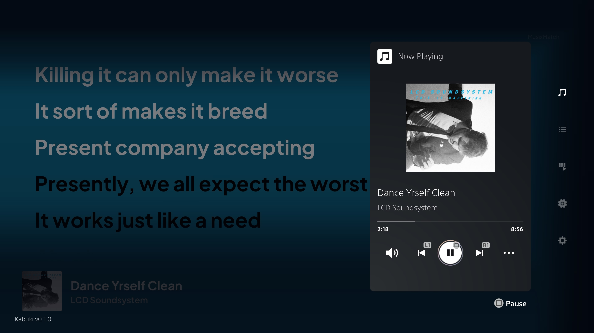
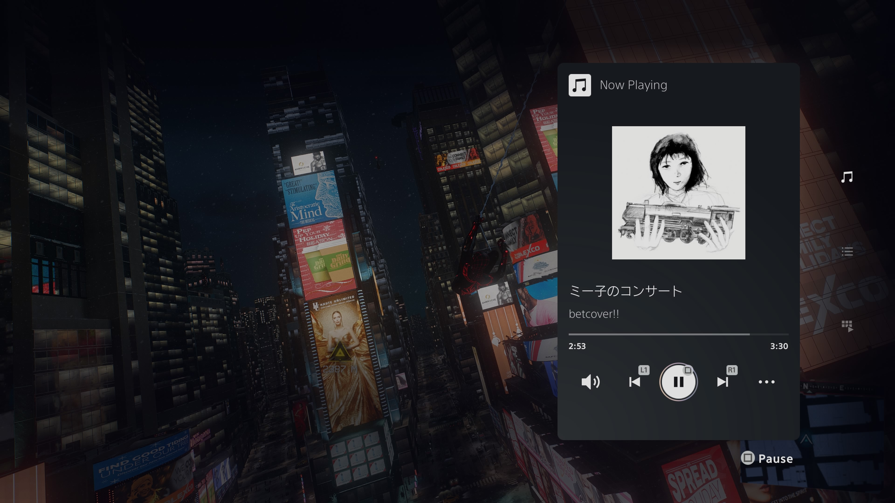
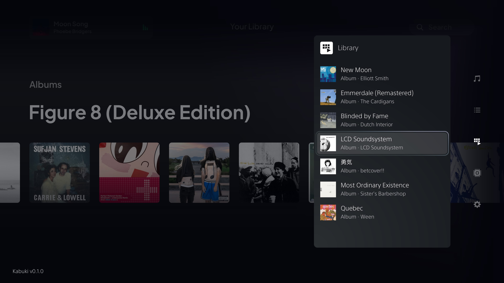
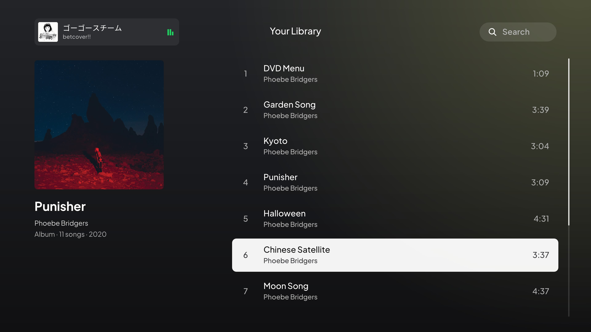

<p align="center">
  <picture>
    <source media="(prefers-color-scheme: dark)" srcset="docs/images/librespot-ps5-dark.png">
    
  </picture>
</p>

<p align="center">
  &nbsp;
  &nbsp;
  &nbsp;
  <a href="LICENSE"></a>&nbsp;
  
</p>

<table>
  <tr>
    <td width="50%"></td>
    <td width="50%"></td>
  </tr>
  <tr>
    <td width="50%"></td>
    <td width="50%"></td>
  </tr>
</table>

<hr>

<h3 align="center">Spotify Connect on a modified PS5, playing over your games. Now without the USB stick.</h3>

<p align="center"><a href="FIRMWARE-SUPPORT.md">Tested on FW 13.20, other firmware untested. Want yours supported? Read this.</a></p>

<hr>

librespot-ps5 turns a modified PS5 into a Spotify Connect speaker. Pick **PS5 Connect** in the Spotify app and the music plays through the console, and keeps playing while you are in a game.

v2 is a big one. The music no longer goes through a file on a USB drive, you can control it from a control centre over your game ([Kabuki](https://github.com/stupiditytries/kabuki-ps5)), and there is an app on the console for browsing your library, so after the first cast you don't need your phone at all.

It is built on [librespot](https://github.com/librespot-org/librespot), the open-source Spotify client library. Like Librespot, it needs a Spotify Premium account.

> **librespot-ps5 is still experimental!** v2 works on my console, but it's had a lot less time on it than v1. Expect rough edges.

> **Tested on FW 13.20, other firmware untested.** To play over games, v2 reads a few values from inside the console's own music service, at positions found in the 13.20 version of it. A different firmware can move those around, so before touching anything the receiver checks that the music service matches the one it knows, and if it doesn't, it safely refuses to play instead of risking a crash. Give it a go anyway! If it doesn't work on yours, see [Firmware support](FIRMWARE-SUPPORT.md) and I should be able to fix it for everyone on that firmware.

## Getting started

**Go to the [Releases page](../../releases) and download the latest `.zip`.** It has the two programs you need:

- `kabuki-ps5.elf`, the control centre ([Kabuki](https://github.com/stupiditytries/kabuki-ps5)).
- `librespot-ps5.elf`, the Spotify receiver.

Then:

1. Put both on a USB drive (or wherever your payload loader loads from).
2. Load **`kabuki-ps5.elf` first**, then **`librespot-ps5.elf`**. librespot-ps5 needs Kabuki running and will tell you if it isn't.
3. In the Spotify app on your phone, open the device list and pick **PS5 Connect**. The first time, this is also what signs the console in.
4. Hold **L3 + R3** to open Kabuki. Now Playing, Queue and Library are there, over the home screen or a game.

The receiver also installs the **librespot-ps5** app (`PPSA99730`) into `/data/homebrew` the first time it runs, and keeps it up to date. Mount it the way you do your other folder apps.

## What's new in v2

- **No more USB.** The music goes straight to the console's audio instead of through a 12-hour FLAC file on a USB drive. No Streamer track to start, no 14 seconds of silence, no drive to keep plugged in.
- **Controls over your game.** Kabuki's Now Playing card has play/pause, skip, volume and **scrubbing**, with cover art, plus your queue and your library. L1/R1 skip, Square pauses.
- **A proper app on the console.** Browse your albums and playlists, open an album and play from any song, search, like songs, see what's playing.
- **Untethered from your phone.** Cast once and the login is saved (encrypted with a key from your console). After that you can pick and play music from the app or from Kabuki without touching your phone.
- **Scrubbing everywhere:** from Kabuki, from the app and from the phone.
- **Synced lyrics** that follow the song. WIP: If a song has no synced lyrics it just says *Lyrics unavailable*.
- **Canvas**, the short looping videos some songs have, plays silently behind Now Playing in the app.
- **Song notifications** when a new track starts, with cover, title and artist.
- **Tapping a song on the phone plays that song** (v1 sometimes jumped to the first song of the playlist), and shuffle stays how you set it.
- Library requests are rate-limited properly, so Spotify doesn't lock you out for an hour when you scroll a lot :P

## What you need

- A PS5 that can load ELF payloads. **Tested on FW 13.20.** The audio only starts when the console's music service matches the 13.20 one it was built against, so other firmware won't play yet and needs testing.
- Spotify Premium, and the Spotify app on a phone on the same network as the console (for the first cast).
- A way to mount folder apps (for the librespot-ps5 app; Kabuki and the receiver work without it).

klogsrv and a USB music drive are **not** needed any more.

## Stopping and updating

To replace the receiver, close the librespot-ps5 app first, then load the new `librespot-ps5.elf`; it asks the old copy to exit. Never run two receivers at once. Reopen the app afterwards so it loads its new version.

The receiver keeps its files in `/data/spotifyps5`: `connect.log` is its log, and a file called `debug.txt` there turns on a detailed log for finding faults. Kabuki keeps its settings and logs in `/data/custom-overlays`.

## How it works

A background program on a PS5 can't simply play sound: its audio output is muted by the console. v1 got around that by writing the music into a file that the console's own USB music player played (see the [v1 README](https://github.com/stupiditytries/librespot-ps5/tree/v0.1.0#how-it-works) for that whole saga).

v2 hands the decoded audio to a small worker running inside the console's own UI process, which plays it through the same music path the console uses for its own music. That path keeps going over games, so the console's volume and mute work as usual. The worker checks the console's music service against the exact firmware it was built for before it touches anything, and refuses and cleans up if anything doesn't match.

```
phone ── Spotify Connect ──> librespot-ps5 (receiver)
                                  │ decoded audio
                                  v
                       worker in the console's UI ──> the console's music output
                                  ^
         Kabuki (L3 + R3) ────────┤ controls, queue, library
         librespot-ps5 app ───────┘ browse, search, lyrics, Canvas
```

The app only draws and sends commands. Spotify, the login, the caches and the audio all stay in the receiver.

## Building

Everything is built with the [PS5 Payload SDK](https://github.com/ps5-payload-dev/sdk) on Linux or WSL. GitHub Actions builds the release from this repository on every tag; `tools/ci/` has the exact steps and pinned versions, and they work locally too:

```bash
bash tools/ci/setup-deps.sh "$HOME/librespot-ps5-deps"
source "$HOME/librespot-ps5-deps/env.sh"
bash tools/ci/build-release.sh
```

That runs the tests, builds the app (`player/`), embeds it in the receiver and leaves `dist/librespot-ps5.elf`. The pieces:

- `connect/`: the Rust receiver library (librespot, Kabuki provider, library, search, lyrics, Canvas).
- `connectd/modular/`: the receiver program and the audio transport.
- `player/`: the librespot-ps5 app (Borealis).
- `vendor/`: patched copies of librespot's core and Connect crates, and the ShellUI loader.

## Credits

- [librespot](https://github.com/librespot-org/librespot), which does all the Spotify work. Big thank you to the contributors for making an awesome project! :)
- The [PS5 Payload SDK](https://github.com/ps5-payload-dev/sdk) from the ps5-payload-dev project.
- [ps5-native-app-boilerplate](https://github.com/blackbearreloaded/ps5-native-app-boilerplate) and the [PS5 OpenGL SDK](https://github.com/blackbearreloaded/ps5-opengl) by BlackBearReloaded, which the app is built with.
- [Borealis](https://github.com/xfangfang/borealis) for the app's UI and [FFmpeg](https://ffmpeg.org) for Canvas videos.

## License

librespot-ps5 is free software under the [GNU General Public License, version 3 or later](LICENSE). The program is linked with the PS5 Payload SDK, which is under the same licence.

`vendor/librespot-core` and `vendor/librespot-connect` are copies of librespot's crates with changes for the console; librespot is under the MIT licence, which is in those folders. The licences for the app's fonts and FFmpeg are in `player/assets/fonts` and installed with the app.

## Disclaimer

This project is not affiliated with or endorsed by Spotify or Sony. Using an unofficial client may be against Spotify's terms of use. It does not let you download music and it does not work without Premium.

Anthropic's Opus and Sonnet models were used during development.
