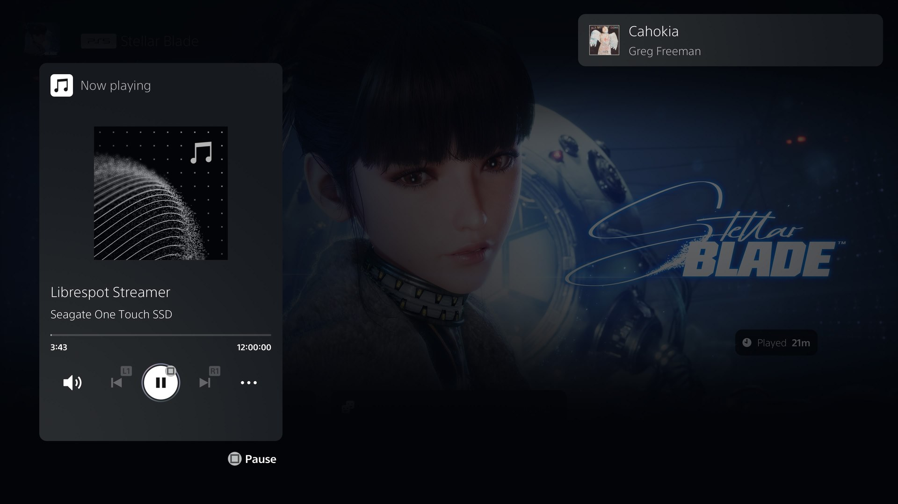

<p align="center">
  <picture>
    <source media="(prefers-color-scheme: dark)" srcset="docs/images/librespot-ps5-dark.png">
    
  </picture>
</p>

<p align="center">
  &nbsp;
  &nbsp;
  &nbsp;
  <a href="LICENSE"></a>&nbsp;
  
</p>

<p align="center">
  
</p>

<hr>

<h3 align="center">Spotify Connect on a modified PS5, playing over your games</h3>

<hr>

librespot-ps5 turns a modified PS5 into a Spotify Connect speaker. Pick **PS5 Connect** in the Spotify app on your phone and the music plays through the console, and keeps playing while you are in a game.

It is built on [librespot](https://github.com/librespot-org/librespot), the open-source Spotify client library. Like Librespot, it needs a Spotify Premium account.

> **librespot-ps5 is still experimental!** While it works on my console, there are unfinished and incomplete features.

## Download

Get `librespot-ps5.elf` from the [Releases page](https://github.com/stupiditytries/librespot-ps5/releases). The release notes there have the short version of how to use it.

## What it does

- Shows up as a device in the Spotify app. You pair from the app; no password is typed on the console.
- Plays over games, through the console's own music player, so the console's volume, mute and Music card all work as usual.
- Play, pause, skip, seek and volume from the phone, heard about two seconds later.
- A notification with the cover, title and artist when a track starts.
- A **Stop Librespot** track that stops the stream when you play it.
- The saved login is encrypted with a key from your console, and the account name is kept out of the logs.

## What you need

- A PS5 that can load ELF payloads.
- [klogsrv](https://github.com/ps5-payload-dev/klogsrv) running on the console (the program reads the console's log through it).
- A USB drive the console plays music from (exFAT or FAT32, not one formatted as extended storage), with about 8 GB free.
- Spotify Premium, and the Spotify app on a phone on the same network as the console.

## Using it

1. Put `librespot-ps5.elf` on a USB drive and load it with your payload loader.
2. On the console, open the Music card, go to your USB drive, open the folder **Start Librespot** and play **Librespot Streamer**. The program makes the folder and the track the first time it runs.
3. In the Spotify app, open the device list and pick **PS5 Connect**. The first time, this is also what signs the console in.
4. Start a game. The music carries on.

After pressing play on the console there are about 14 seconds of silence before the music starts. That is expected; see below.

To stop, open the folder **Librespot Controls** and play **Stop Librespot**, or just pause from the phone.

## How it works

A background program on a PS5 cannot simply play sound. Its audio output is muted by the console, and asking the console's media service to play for it crashes that service. An app can play sound, but apps are closed when a game starts.

The console's own USB music player has neither problem: it keeps playing over games. So this program never plays anything. It writes the music into a file on the USB drive, and the console's player plays that file.

```
phone ── Spotify Connect ──> librespot (on the PS5)
                                  │ decoded audio
                                  v
                            stream writer ──> "Librespot Streamer.flac" on the USB drive
                                  ^                        │
                                  │ "started" / "ended"    v
                            the console's log <── the console's USB music player
```

**librespot-ps5 uses one long background track.** The file is an uncompressed FLAC with a stated length of 12 hours. Every Spotify track goes into it one after the other, so on the console it is a single track called Librespot Streamer.

**Delay minimisation:** Left alone, the console's player reads about nine seconds ahead of what you hear, so anything written into the file is heard nine seconds late at best. The player decides how long the file is when it opens it, though. So the file is full size when the player opens it, and a moment later the program cuts it off just after the last audio it has written and lets it grow from there. The player reaches the end, finds nothing more to read, and waits. It can no longer read ahead, and the delay becomes whatever gap the program keeps, which is two seconds.

That is also why there is silence at the start: the player loads the first few seconds of the file before the program is able to cut it, so those seconds have to be something harmless.

**Knowing where the player is:** The console's log has a line when its player starts something and another when it ends or pauses. The program reads those lines and runs its own clock from them. The log never says which file, so a few things are worked out from timing: the Stop track is recognised by its length, for example.

**Things the console's player is fussy about**, learned the hard way from crashes and silence :P :

- Uncompressed audio contains its own sample values as raw bytes, and two common values in quiet music are the same two bytes that mark the start of a FLAC frame. The console's player takes the first such pair it finds after seeking as genuine, and crashes. The writer nudges those samples by one step so the pair never appears inside the audio.
- When you pause on the console and resume, the player opens the file again and finds its place from the file's size. So on a pause the file is put back to full size, and cut off again once the player is going.
- Music that has been played is replaced with silence a few seconds later, so the file never holds more than a few seconds of audio.

**Pairing.** The program announces itself on the network the way any Spotify speaker does. Picking it in the app hands it a login for your account, encrypted with an identifier of the console. This information never goes anywhere besides to Spotify.

## Settings

The program keeps its files in `/data/spotifyps5`. `tape.txt` there holds the settings and is written with the defaults the first time:

| Setting | Default | Meaning |
|---|---|---|
| `lead` | `2` | Seconds of audio kept written ahead of what is heard. This is the delay. |
| `idle` | `600` | Seconds without audio after which nothing more is written to the drive until music returns. |
| `hours` | `12` | Length of the stream file. One hour is about 635 MB. |
| `toast` | `1` | Show a notification when a track starts. |
| `toast_style` | `0` | Which kind of console notification is used: `0` is the console's own small music notice. |

A file called `debug.txt` in the same folder turns on a detailed log, for finding faults.

## Not finished

- **Pausing from the console** works by a workaround and has a cost: about 14 seconds of silence when you resume. Pausing from the phone has none.
- **Next and Previous on the console** do nothing useful. Use the phone.
- After 12 hours the stream file is full and has to be started again.
- Only tested on one console and one drive.
- No cover art/metadata on the console's Music card; the console does not show covers for USB music and I couldn't find a way to get this reliably working without registry edits.

## Building

The receiver is a Rust library (`connect`) linked into a small C program (`connectd`), built with the [PS5 Payload SDK](https://github.com/ps5-payload-dev/sdk) on Linux or WSL:

```bash
bash connectd/build.sh
```

The script's header lists what it expects to find. The tests for the stream writer run on any PC and need nothing from the console:

```bash
cd connect && cargo test --release --lib
```

They run the writer against a pretend console player that follows what the real one was seen to do.

## Credits

- [librespot](https://github.com/librespot-org/librespot), which does all the Spotify work. Big thank you to the contributors for making an awesome project! :)
- The [PS5 Payload SDK](https://github.com/ps5-payload-dev/sdk) and [klogsrv](https://github.com/ps5-payload-dev/klogsrv) from the ps5-payload-dev project.

## License

librespot-ps5 is free software under the [GNU General Public License, version 3 or later](LICENSE). The program is linked with the PS5 Payload SDK, which is under the same licence.

`vendor/librespot-core` is a copy of librespot's core crate with two changes (audio keys are asked for again when a request times out, and the saved login is encrypted). librespot is under the MIT licence, which is in that folder.

## Disclaimer

This project is not affiliated with or endorsed by Spotify or Sony. Using an unofficial client may be against Spotify's terms of use. It does not let you download music and it does not work without Premium.
